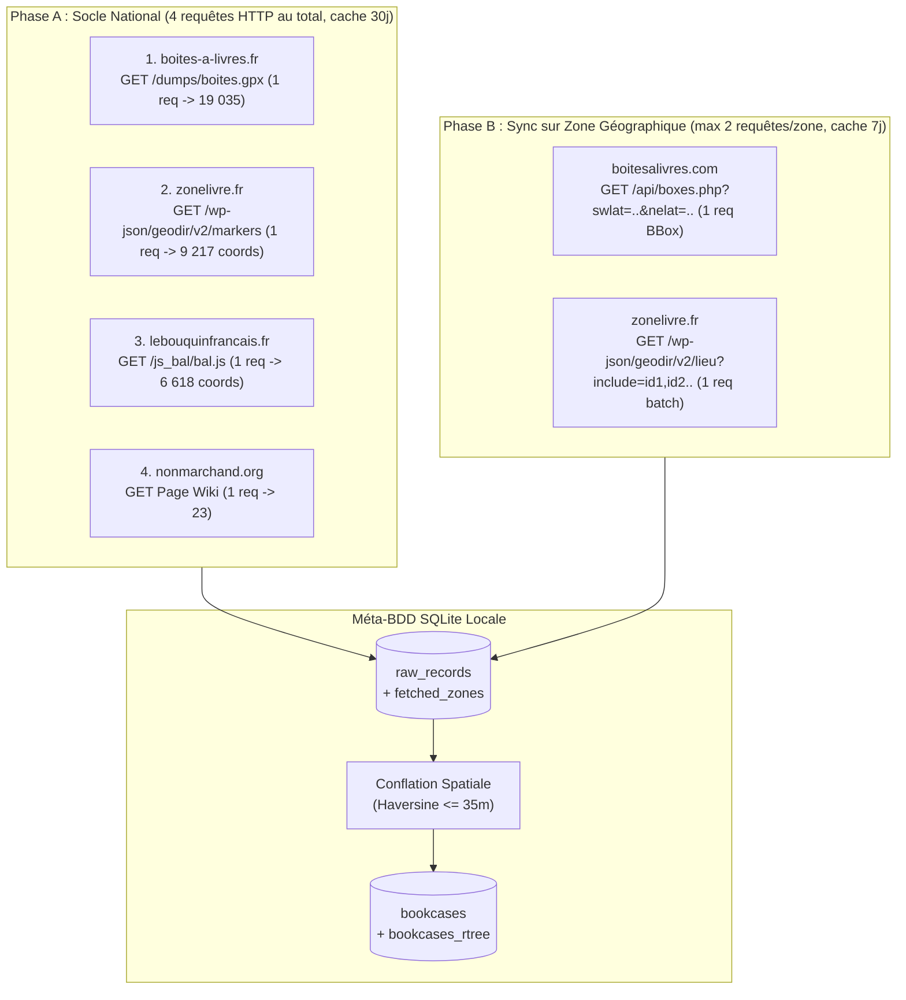

# Plan de Réalisation (Tasks) — AllBAL

> [!IMPORTANT]
> Ce plan est conçu pour être exécuté séquentiellement par un modèle d'implémentation plus léger. Toutes les URLs d'API, formats de payloads et règles métier ont déjà été audités et vérifiés dans [`doc/sources_analysis.md`](./sources_analysis.md) et [`doc/adr.md`](./adr.md). **Aucune phase d'exploration web supplémentaire n'est nécessaire.**

---

## Vue d'ensemble du pipeline « Fair-Use »



---

## Étape 1 : Initialisation du projet et Base de données Spatiale (`src/allbal/db.py`)

### Objectif
Mettre en place l'arborescence Python, les dépendances et la base SQLite avec index spatial R\*Tree et table de suivi des zones géographiques déjà synchronisées (`fetched_zones`).

### Spécifications exactes
1. Créer `pyproject.toml` et `.gitignore` (ignorer `.venv/`, `data/raw/*`, `data/*.db`, `__pycache__/`).
2. Dépendances : `fastapi`, `uvicorn`, `httpx`, `beautifulsoup4`, `pytest`.
3. Dans `src/allbal/db.py`, créer le schéma SQLite suivant :
   ```sql
   CREATE TABLE IF NOT EXISTS raw_records (
       id INTEGER PRIMARY KEY AUTOINCREMENT,
       source_name TEXT NOT NULL,          -- 'boites_a_livres_fr', 'boitesalivres_com', 'zonelivre', 'lebouquinfrancais', 'nonmarchand'
       source_id TEXT NOT NULL,
       lat REAL NOT NULL,
       lon REAL NOT NULL,
       title TEXT,
       address TEXT,
       postcode TEXT,
       city TEXT,
       description TEXT,
       photo_url TEXT,
       status TEXT,                        -- ex: 'pleine', 'vide', 'abimee', ou NULL
       source_url TEXT,
       is_enriched INTEGER NOT NULL DEFAULT 1, -- 0 pour les marqueurs légers (zonelivre/lebouquinfrancais) en attente d'enrichissement local
       raw_json TEXT,
       fetched_at TEXT DEFAULT CURRENT_TIMESTAMP,
       UNIQUE(source_name, source_id)
   );

   CREATE TABLE IF NOT EXISTS fetched_zones (
       id INTEGER PRIMARY KEY AUTOINCREMENT,
       source_name TEXT NOT NULL,
       min_lat REAL NOT NULL,
       max_lat REAL NOT NULL,
       min_lon REAL NOT NULL,
       max_lon REAL NOT NULL,
       fetched_at TEXT DEFAULT CURRENT_TIMESTAMP
   );

   CREATE TABLE IF NOT EXISTS bookcases (
       id INTEGER PRIMARY KEY AUTOINCREMENT,
       lat REAL NOT NULL,
       lon REAL NOT NULL,
       title TEXT,
       address TEXT,
       postcode TEXT,
       city TEXT,
       description TEXT,
       photo_url TEXT,
       status TEXT,
       source_count INTEGER NOT NULL DEFAULT 1,
       sources_list TEXT NOT NULL,         -- JSON array ex: '["boites_a_livres_fr", "zonelivre"]'
       updated_at TEXT DEFAULT CURRENT_TIMESTAMP
   );

   CREATE TABLE IF NOT EXISTS bookcase_sources (
       bookcase_id INTEGER NOT NULL REFERENCES bookcases(id) ON DELETE CASCADE,
       raw_record_id INTEGER NOT NULL REFERENCES raw_records(id) ON DELETE CASCADE,
       PRIMARY KEY (bookcase_id, raw_record_id)
   );

   CREATE VIRTUAL TABLE IF NOT EXISTS bookcases_rtree USING rtree(
       id,
       min_lat, max_lat,
       min_lon, max_lon
   );
   ```
4. Implémenter dans `src/allbal/db.py` :
   - `haversine_m(lat1, lon1, lat2, lon2) -> float` (distance en mètres).
   - `bbox_from_radius(lat: float, lon: float, radius_km: float) -> tuple[float, float, float, float]` : retourne `(min_lat, max_lat, min_lon, max_lon)`.
   - `is_zone_cached(conn, source_name: str, min_lat: float, max_lat: float, min_lon: float, max_lon: float, max_age_days: int = 7) -> bool` : vérifie dans `fetched_zones` si une zone englobante couvre déjà `[min_lat, max_lat, min_lon, max_lon]` depuis moins de `max_age_days`.
   - `search_within_radius(conn, lat: float, lon: float, radius_km: float, sources: list[str] | None = None) -> list[dict]` :
     - Filtre d'abord via `bookcases_rtree` sur la bounding box, puis affine avec `haversine_m <= radius_km * 1000` et trie par `distance_m ASC`.

### Critère de validation (Test)
- `pytest tests/test_db_spatial.py` vérifie l'insertion, le cache de zone `is_zone_cached` et la recherche par rayon.

---

## Étape 2 : Socle National « Fair-Use » en 4 Requêtes Uniques (Dumps & Marqueurs)

### Objectif
Implémenter les 4 connecteurs globaux qui récupèrent chacun l'intégralité de leurs points en **1 seule requête HTTP** (avec cache fichier dans `data/raw/`, `TTL = 30 jours`).

### Spécifications exactes
1. **`src/allbal/ingest/osm_overpass.py` (`source_name = 'boites_a_livres_fr'`) — 1 requête** :
   - Télécharge `https://www.boites-a-livres.fr/dumps/boites.gpx` si absent de `data/raw/boites.gpx`.
   - Parse chaque `<wpt lat="..." lon="...">` (namespace GPX `http://www.topografix.com/GPX/1/1`), extrait `<name>`, `<desc>`, `<link href="...">` (`is_enriched = 1`).
2. **`src/allbal/ingest/zonelivre.py` (`source_name = 'zonelivre'`) — Mode initial : 1 seule requête `/markers`** :
   - Télécharge `GET https://boite.a.livres.zonelivre.fr/wp-json/geodir/v2/markers?post_type=gd_place` (cache `data/raw/zonelivre_markers.json`).
   - Parse le tableau `.items` (9 217 éléments) :
     - `source_id = str(item["m"])`
     - `lat = float(item["lt"])`, `lon = float(item["ln"])`
     - `city = item.get("t")`, `title = item.get("t")`
     - `is_enriched = 0` (indique que seules les coordonnées et la ville sont chargées, sans l'adresse de rue complète).
3. **`src/allbal/ingest/lebouquinfrancais.py` (`source_name = 'lebouquinfrancais'`) — 1 requête** :
   - Télécharge `https://lebouquinfrancais.fr/js_bal/bal.js` (cache `data/raw/lebouquinfrancais_bal.js`).
   - Extrait `var villes = {...};` via regex, valide `-90 <= lat <= 90` et `-180 <= lon <= 180`, insère avec `is_enriched = 0`.
4. **`src/allbal/ingest/nonmarchand.py` (`source_name = 'nonmarchand'`) — 1 requête** :
   - Télécharge `https://nonmarchand.org/pmwiki/EspacesDeGratuite/RechercheCarteBo%C3%AEte%C3%80Livres` (cache `data/raw/nonmarchand.html`).
   - Parse `<dl class="map">` (~23 entrées), insère avec `is_enriched = 1`.

### Critère de validation (Test)
- `pytest tests/test_parsers.py` teste les 4 parseurs sur des fixtures locales sans appel réseau.

---

## Étape 3 : Synchronisation Fair-Use par Zone Géographique (`boitesalivres.com` & Enrichissement `zonelivre.fr`)

### Objectif
Lorsque l'utilisateur interroge un périmètre `(lat, lon, radius_km)`, interroger les APIs **uniquement sur cette zone géographique** en **au plus 2 requêtes HTTP** (et 0 requête si la zone est déjà en cache dans `fetched_zones`).

### Spécifications exactes
1. **`fetch_boitesalivres_zone(conn, min_lat, max_lat, min_lon, max_lon)` dans `src/allbal/ingest/boitesalivres_com.py`** :
   - Vérifie `is_zone_cached(conn, 'boitesalivres_com', min_lat, max_lat, min_lon, max_lon, max_age_days=7)`. Si vrai, ne fait rien (0 requête).
   - Sinon, exécute **1 seule requête** :
     `GET https://boitesalivres.com/api/boxes.php?zoom=10&swlat={min_lat}&swlng={min_lon}&nelat={max_lat}&nelng={max_lon}`
   - Insère (`INSERT OR REPLACE`) les boîtes reçues dans `raw_records` avec `source_name = 'boitesalivres_com'`, `address = b["adresse"]`, `postcode = b["cp"]`, `city = b["ville"]`, `description = b["description"]`, `photo_url = b["photo_url"]`, `status = b.get("etat")`, `is_enriched = 1`.
   - Enregistre la zone dans `fetched_zones`.
2. **`enrich_zonelivre_zone(conn, min_lat, max_lat, min_lon, max_lon)` dans `src/allbal/ingest/zonelivre.py`** :
   - Cherche dans `raw_records` les entrées où `source_name = 'zonelivre' AND is_enriched = 0` situées dans `[min_lat, max_lat, min_lon, max_lon]` (limité aux 100 plus proches).
   - S'il n'y en a aucune, ne fait rien (**0 requête**).
   - Sinon, exécute **1 seule requête groupée** avec tous les IDs séparés par une virgule :
     `GET https://boite.a.livres.zonelivre.fr/wp-json/geodir/v2/lieu?include={id1,id2,...}&per_page=100`
   - Met à jour `raw_records` pour ces IDs avec `address = item["street"]`, `postcode = item["zip"]`, `city = item["city"]`, `source_url = item["link"]`, `photo_url = item.get("featured_image", {}).get("src")`, et passe `is_enriched = 1` (pour qu'elles ne soient plus jamais redemandées).
3. **Orchestrateur `sync_geographic_zone(conn, lat: float, lon: float, radius_km: float)`** :
   - Calcule `(min_lat, max_lat, min_lon, max_lon)` avec une légère marge (ex: `max(radius_km, 10.0)` km pour mettre en cache un secteur pertinent autour de l'utilisateur).
   - Appelle `fetch_boitesalivres_zone` + `enrich_zonelivre_zone`.
   - Si de nouveaux enregistrements ont été ajoutés ou enrichis, relance la déduplication.

---

## Étape 4 : Algorithme de Déduplication et Fusion (`src/allbal/deduplicate.py`)

### Objectif
Construire la table consolidée `bookcases` et son index `bookcases_rtree` à partir de `raw_records`.

### Spécifications exactes
1. Vider `bookcases`, `bookcase_sources` et `bookcases_rtree` avant reconstruction.
2. Parcourir les enregistrements de `raw_records` dans l'ordre de priorité des sources :
   1. `boites_a_livres_fr` (OSM)
   2. `boitesalivres_com`
   3. `zonelivre`
   4. `lebouquinfrancais`
   5. `nonmarchand`
3. Pour chaque enregistrement brut `r` :
   - Chercher dans `bookcases_rtree` s'il existe déjà une boîte canonique dans un rayon de **100 mètres** (`haversine_m <= 100.0`).
   - **Si aucune boîte existante n'est à <= 100 m** :
     - Créer une nouvelle entrée dans `bookcases` et `bookcases_rtree`, et lier dans `bookcase_sources`.
   - **Si une boîte existante `b` est trouvée à <= 100 m** :
     - Lier `r` à `b` dans `bookcase_sources`.
     - Mettre à jour `b` en complétant les champs manquants (`address`, `postcode`, `city`, `description`, `photo_url`, `status`) s'ils étaient vides dans `b` mais présents dans `r`.
     - Ajouter `r.source_name` à `b.sources_list` (sans doublon) et mettre à jour `b.source_count`.

### Critère de validation (Test)
- `pytest tests/test_deduplicate.py` vérifie que des points distants de moins de 100 m (ex: 11 m et 67 m) fusionnent en 1 seule boîte et combinent leurs attributs, tandis qu'un point à plus de 100 m (ex: 333 m) reste distinct.

---

## Étape 5 : Interface CLI et API Backend FastAPI (`src/allbal/cli.py` & `src/allbal/api.py`)

### Objectif
Permettre de lancer l'ingestion, la déduplication et le serveur web en une commande.

### Spécifications exactes
1. **`src/allbal/cli.py`** :
   - `python -m allbal.cli init` (télécharge les 4 dumps/marqueurs globaux en 4 requêtes HTTP au total + lance `dedup`)
   - `python -m allbal.cli sync-zone --lat <lat> --lon <lon> [--radius-km 15]` (synchronise `boitesalivres.com` et enrichit `zonelivre` uniquement sur cette zone géographique + lance `dedup`)
   - `python -m allbal.cli dedup` (lance la déduplication et affiche le rapport de fusion)
   - `python -m allbal.cli stats` (affiche le nombre d'entrées par source, les zones en cache et le nombre de boîtes uniques)
   - `python -m allbal.cli serve [--port 8000]` (démarre Uvicorn)
2. **`src/allbal/api.py`** :
   - `GET /api/bookcases?lat={lat}&lon={lon}&radius_km={radius_km}&sources={csv}&sync=true` :
     - Si `sync=true` (par défaut), appelle `sync_geographic_zone(conn, lat, lon, radius_km)` qui interroge `boitesalivres.com` (1 requête BBox si zone non cachée) et enrichit `zonelivre.fr` (1 requête batch `include` si fiches non enrichies dans la zone).
     - Retourne `{ "count": N, "center": {"lat": lat, "lon": lon}, "radius_km": radius_km, "zone_cached": true|false, "items": [...] }` triés par `distance_m` croissant.
   - `GET /api/bookcases/bbox?south={s}&west={w}&north={n}&east={e}&limit=2000` :
     - Retourne les boîtes déjà présentes en base locale dans le rectangle affiché par la carte.
   - `GET /api/stats` :
     - Retourne les compteurs par source, le nombre de zones synchronisées et le total consolidé.
   - `GET /api/export.geojson` :
     - Exporte les résultats d'un périmètre (ou toute la base) au format standard GeoJSON `FeatureCollection`.
   - Monte `src/allbal/static/` sur `/`.

---

## Étape 6 : Interface Cartographique et Recherche par Périmètre (`src/allbal/static/`) [TERMINEE]

### Objectif
Offrir une interface claire, rapide et responsive sur ordinateur et mobile répondant exactement au besoin : *« lister toutes les Boîtes à Livres près de moi ou dans un périmètre donné »*.

### Spécifications réalisées
1. **Barre de contrôle supérieure / latérale** :
   - Bouton **« 📍 Autour de moi »** utilisant `navigator.geolocation.getCurrentPosition`.
   - Champ de recherche d'adresse / ville avec autocomplétion connectée à `https://api-adresse.data.gouv.fr/search/?q=...&autocomplete=1&limit=5` (avec debounce de 280 ms).
   - Sélecteur de **rayon (périmètre)** : `1 km`, `2 km`, `5 km`, `10 km`, `20 km`, `50 km`.
   - Filtres par source avec compteurs dynamiques issus de `/api/stats` et filtre « Avec photo ».
   - Case à cocher « Synchro web (Fair-use) » pilotant le paramètre `sync` de l'API.
   - Bouton **« 📥 GeoJSON »** pour exporter la sélection courante au format standard GeoJSON `FeatureCollection`.
2. **Double vue synchronisée (Carte + Liste)** :
   - **Carte Leaflet (`#map`)** :
     - Tuiles OpenStreetMap + `Leaflet.markercluster`.
     - Cercle visuel dynamique (`L.circle`) matérialisant le périmètre choisi autour du point de recherche.
     - Marqueurs distinctifs avec icône et couleur : vert étoilé (★) pour les boîtes confirmées par plusieurs sources (`source_count >= 2`), bleu (📖) pour source unique.
     - Popup riche : Titre, adresse postale complète, distance exacte (`m` ou `km`), badges cliquables de sources, état éventuel, photo miniature agrandissable en modal et lien d'itinéraire direct.
   - **Liste latérale (`#list-panel`)** :
     - Liste défilante des boîtes trouvées triées de la plus proche à la plus éloignée.
     - Clic sur une carte centrant la carte et ouvrant le popup (avec zoom automatique dans le cluster).
     - Bascule fluide mobile (onglets Carte / Liste).

### Critère de validation (Test)
- `pytest tests/test_api_integration.py` valide la distribution de `index.html`, `style.css`, `app.js` ainsi que le bon fonctionnement des endpoints `/api/stats`, `/api/bookcases`, `/api/bookcases/bbox` et `/api/export.geojson`.

